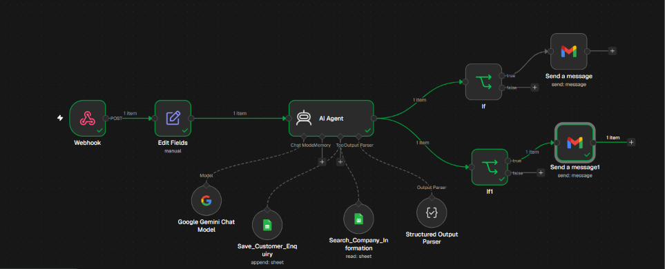
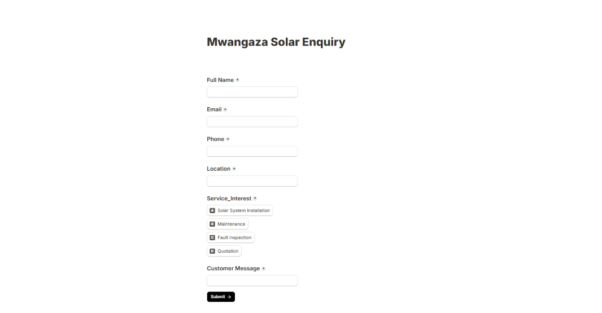
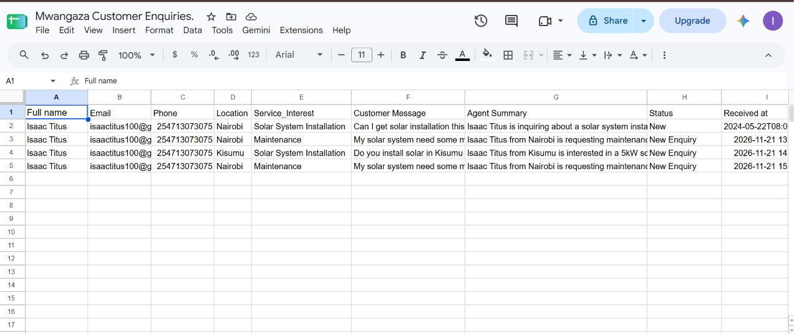
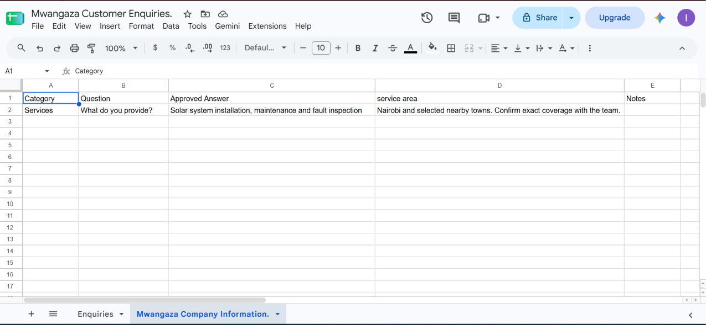
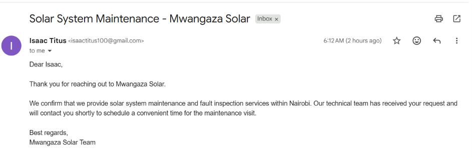
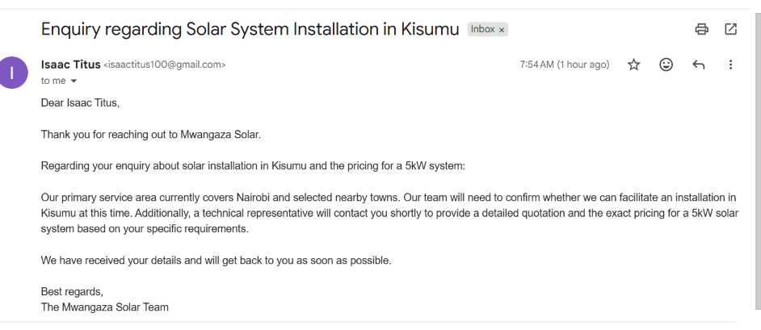
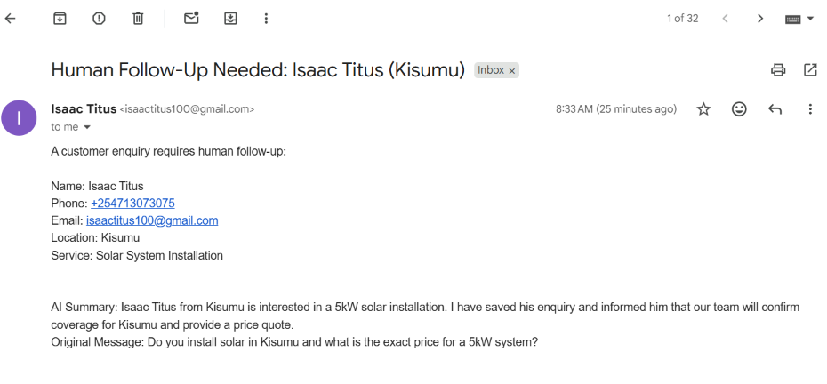

# Mwangaza Solar — Customer Enquiry AI Agent (n8n)

An end-to-end automated customer enquiry workflow built with **n8n**, **Tally**, **Google Gemini**, **Google Sheets**, and **Gmail**. When a customer submits an enquiry via Tally, the AI Agent verifies company facts against an approved knowledge base, logs the enquiry with a live `Africa/Nairobi` timestamp, drafts a grounded reply, and triggers human-in-the-loop escalation for custom quotes or unlisted locations.

---

## Architecture Overview

```text
                                              ┌─► [If: Email contains @] ──► (true) ──► [Gmail: Customer Reply]
[Tally Form] ─► [Webhook] ─► [Edit Fields] ─► [AI Agent]
                                              └─► [If: needs_human_follow_up] ─► (true) ──► [Gmail: Sales Team Alert]
                                                  ▲
                       ┌──────────────────────────┼──────────────────────────┐
            [Google Gemini Model]   [Save_Customer_Enquiry]   [Search_Company_Information]   [Structured Output Parser]
```

### Key Components
* **Trigger (`Webhook` + `Tally`):** Captures incoming `POST` form submissions (`Full Name`, `Email`, `Phone`, `Location`, `Service_Interest`, `Customer Message`).
* **Data Normalization (`Edit Fields`):** Standardizes fields and parses Tally multiple-choice option IDs into clean readable text.
* **AI Agent (`Google Gemini` + `Structured Output Parser`):**
  * **`Search_Company_Information` (`Get Row(s)`):** Retrieves approved facts from `Mwangaza Company Information` so the agent never invents coverage areas or pricing.
  * **`Save_Customer_Enquiry` (`Append Row`):** Logs every valid enquiry into `Mwangaza Customer Enquiries` (`Enquiries` tab) with an AI-generated summary, status, and live Nairobi timestamp.
  * **Structured JSON Output:** Enforces `email_subject`, `email_body`, `enquiry_saved`, `short_summary`, and `needs_human_follow_up`.
* **Parallel Routing & Guardrails (`If` Nodes + `Gmail`):**
  * **Email Guardrail (`contains @`):** Safely skips sending if an email address is missing or invalid while still preserving the lead in Google Sheets.
  * **Human-in-the-Loop Escalation (`needs_human_follow_up == true`):** Alerts the Mwangaza sales team immediately when a customer asks about an unlisted town or custom quotation.

---

## Repository Contents
* [`mwangaza-customer-enquiry-agent.json`](./mwangaza-customer-enquiry-agent.json) — Exported n8n workflow ready to import.
* `01-n8n-workflow-canvas.png` — Complete published n8n workflow canvas.
* `02-tally-form-live.png` — Live Tally customer enquiry form.
* `03-google-sheets-enquiries-log.png` — Logged customer enquiries with AI summaries and timestamps.
* `04-google-sheets-knowledge-base.png` — Approved company information knowledge base.
* `05-test-standard-nairobi-email.png` — Automated reply for a standard Nairobi enquiry.
* `07-test-unlisted-area-customer-reply.png` — Grounded reply for an unlisted location (Kisumu) and custom quote request.
* `8-test-unlisted-area-human-escalation-alert.png` — Internal sales team escalation email.

---

## Screenshots & Test Results

### 1. Published n8n Workflow Canvas


### 2. Live Tally Enquiry Form


### 3. Google Sheets — Enquiries Log & Knowledge Base



### 4. Test Case — Standard Nairobi Service Enquiry


### 5. Test Case — Unlisted Area (Kisumu) & Human Escalation Alert



---

## How to Import & Run
1. Download [`mwangaza-customer-enquiry-agent.json`](./mwangaza-customer-enquiry-agent.json).
2. In **n8n**, create a new workflow, click the top-right menu (`•••`) → **Import from File**, and select the JSON file.
3. Reconnect your **Google Gemini**, **Google Sheets**, and **Gmail** credentials.
4. Update the Google Sheet IDs in `Save_Customer_Enquiry` and `Search_Company_Information` to point to your own spreadsheet tabs.
5. Click **Publish** in n8n and paste the **Production Webhook URL** into your Tally form's **Webhooks** integration.
